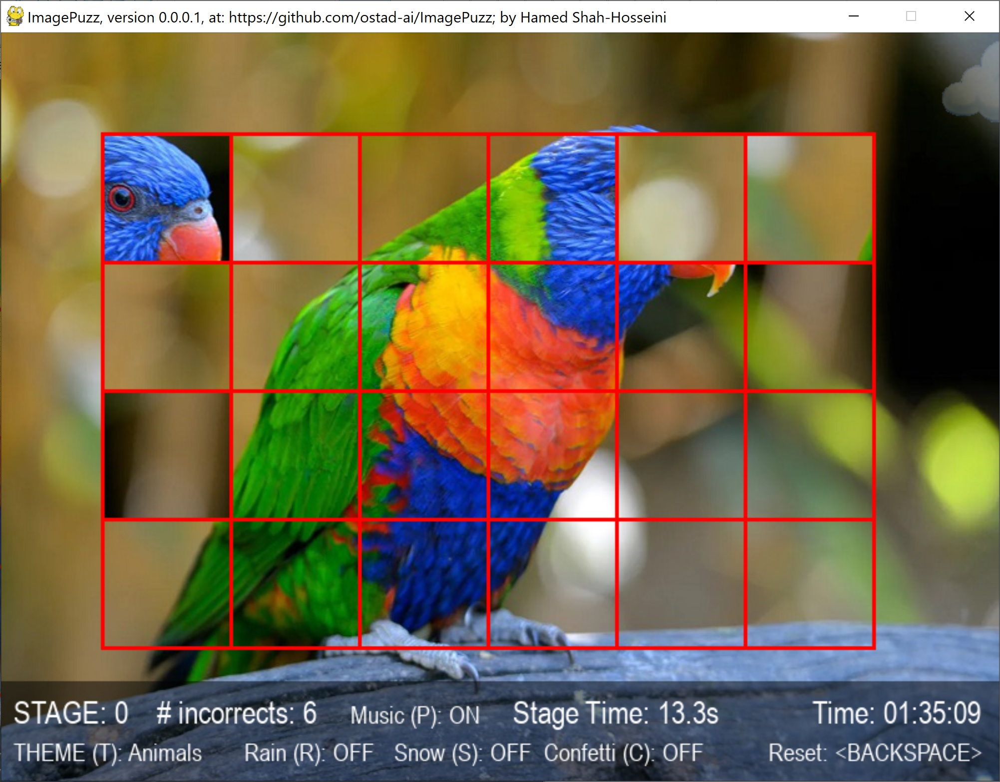
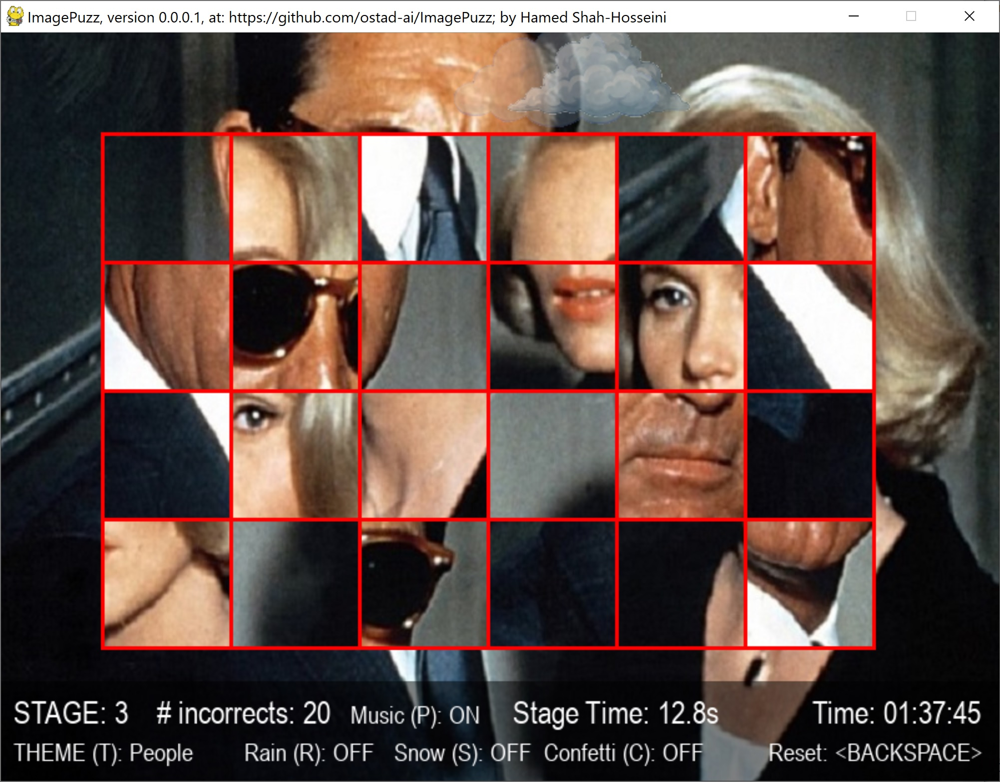
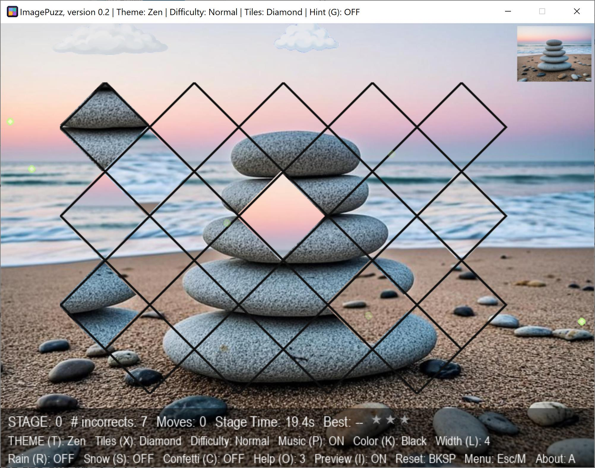
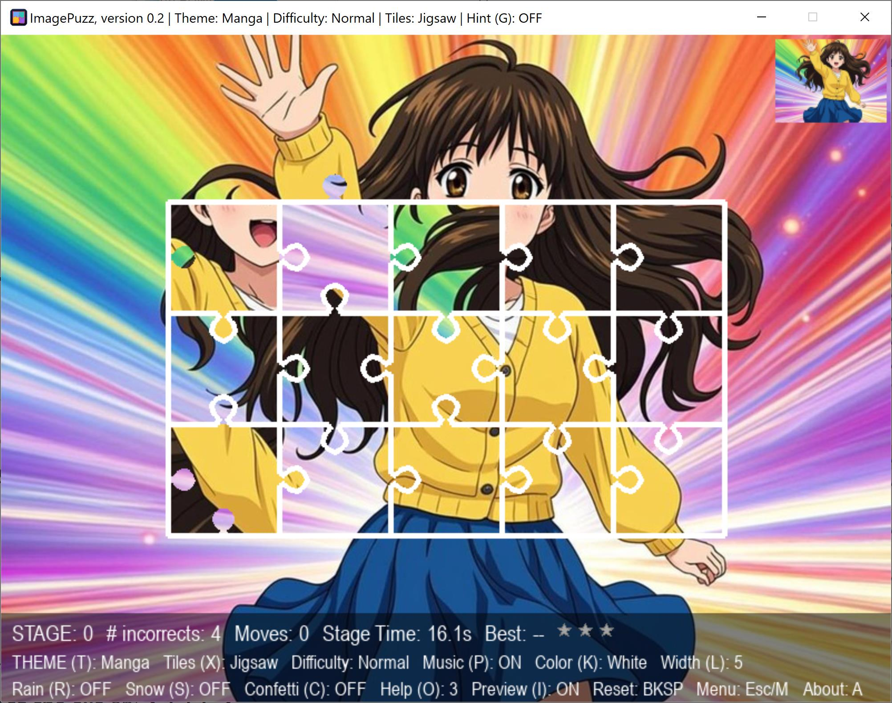

# ImagePuzz

Turn any picture into a puzzle — including your own photos.

**ImagePuzz** is a small picture-puzzle game for Windows: it cuts a picture
into tiles, shuffles them, and you drag the tiles around and swap them until
the picture is whole. It ships with five picture themes — Nature, People,
Animals, Zen and Manga — each with its own soundtrack, plus a **My Photos**
theme that turns your own pictures into puzzles.

Made with Python and pygame, compiled into a single portable `.exe`. No installer, no setup: download, double-click, play.

> If you like ImagePuzz, please **give us a star** ⭐ — it means a lot to a
> small project like this. Thank you! :)

---

<table>
<tr>
<td>
Figure 1: A snapshot of ImagePuzz, version 0.0.0.1, with an image from theme Nature, while playing the game.</td>
    
<td>
Figure 2: A snapshot of ImagePuzz, version 0.0.0.1, with an image from theme People, while playing the game.</td>
</tr>
<tr>
<td>
Figure 3: A snapshot of ImagePuzz, version 0.2, with an image from theme Zen, while playing the game.</td>
    
<td>
Figure 4: A snapshot of ImagePuzz, version 0.2, with an image from theme Manga, while playing the game.</td>
</tr>
</table>

---

## Download & run (Windows)

1. Open the [**Releases**](https://github.com/ostad-ai/ImagePuzz/releases/tag/v0.2) page.
2. Download **imagepuzz.exe** from the latest release (**v0.2**).
3. Double-click `imagepuzz.exe` — that's all.

**"Windows protected your PC"?** The exe is not digitally signed
(code-signing certificates cost real money), so SmartScreen may show a
warning the first time you run it. Click **More info** → **Run anyway** —
the exe is compiled straight from the source code in this repository, and
nothing else is inside.

## Puzzle your own photos

On first run, the game creates a folder **next to the exe**:

```
puzzle-images/my-photos/
```

- Drop your own `.jpg` / `.png` pictures into it.
- Restart the game and press **T** until the **My Photos** theme appears —
  your pictures are now puzzles.
- Pictures of other sizes are automatically cropped to 800x600 (your
  original files are never modified).
- A sample photo is included as a starting point; delete it whenever you like.
- **The game never overwrites your photos**, and everything you put in that
  folder stays there even after you download a newer version of the game.

Your progress is saved automatically too: the game writes
`puzzle-data/resume.json` and `puzzle-data/best_times.json` next to the exe,
so you can close it at any moment and continue later exactly where you were.

## How to play

Drag a tile onto another tile to swap them. Complete the picture to finish
the stage — you earn up to 3 stars per stage, and your best times and best
moves are recorded for every stage.

| Key | Action |
| --- | --- |
| **Mouse drag** | Swap two tiles |
| **1 / 2 / 3** | Difficulty: Easy / Normal / Hard |
| **X** | Tile shape: Square, Jigsaw, Diamond, Hexagon, Triangle |
| **T** | Next theme |
| **H** (hold) | Peek at the finished picture |
| **G** | Ghost hint on/off |
| **O** | Help: places a tile for you (3 per stage) |
| **I** | Corner preview on/off |
| **+ / - / 0** | Zoom in / out / reset (arrow keys pan while zoomed) |
| **K / L** | Grid colour / grid line thickness |
| **R / S / C** | Rain / snow / confetti |
| **P** | Pause / resume the music |
| **Backspace** | Reset the stage |
| **Esc / M** | Settings menu |
| **A** | About box |

## Author

**Hamed Shah-Hosseini**
GitHub: https://github.com/ostad-ai/ImagePuzz

## License

Released under the [MIT License](LICENSE).
